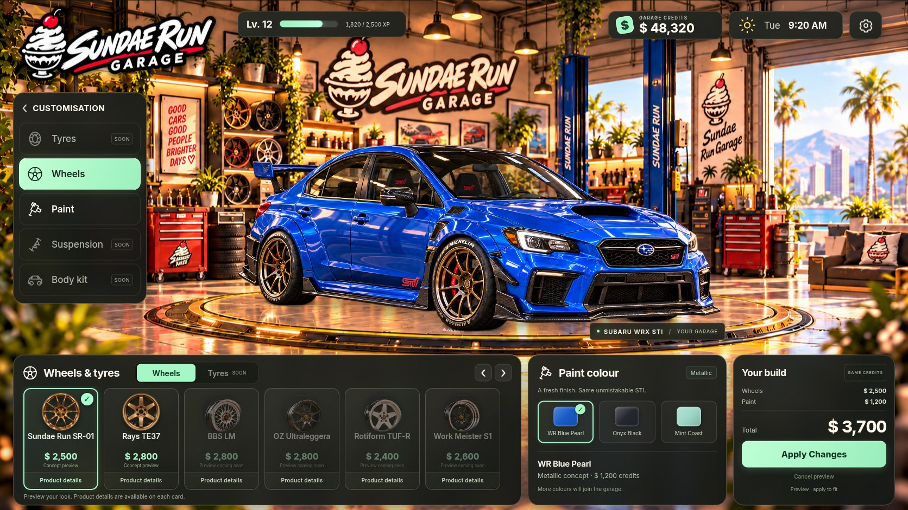

# Sundae Run Garage

A fixed-camera STI customisation screen with a warm Sundae Run workshop, a gold turntable, live HTML controls, and separate car artwork. The first supported set is blue, black, and mint paint with two bronze wheel concepts. Other wheel designs, tyres, suspension and body kits remain unavailable until matching artwork is prepared.



## Download and play

**[Download Sundae Run ZIP](https://github.com/bukenbekruip/sundaerun/raw/refs/heads/main/downloads/Sundae-Run-Playable.zip)** (21 MB). Sign in to GitHub with access to this repository if prompted. Extract the ZIP, then open `OPEN-SUNDAE-RUN.html` in Chrome or Edge. No Node.js installation is needed for this download.

If the download does not start, [open the ZIP's GitHub file page](https://github.com/bukenbekruip/sundaerun/blob/main/downloads/Sundae-Run-Playable.zip) and choose **Download raw file**. The file is a copy of the verified portable build recorded in `qa/current/release.json`.

## Run the source

Use Node.js 22.12 or newer; the cloud setup uses Node 24. Open a terminal in the folder containing `package.json`:

```sh
npm ci
npm run dev
```

Open the URL Vite prints. On Windows, use `npm.cmd` if PowerShell blocks `npm.ps1`.

## Build a portable game

```sh
npm run build:standalone
```

The current portable game is `dist/OPEN-SUNDAE-RUN.html`. It embeds the code, fonts and runtime images in one file. Save that file to your computer and open it in Chrome or Edge. The legacy `OPEN-THIS-GAME.html` is the old V2 diagnostic demo and is kept as handover history.

For a normal web deployment, publish the contents of `dist/` after `npm run build`. Preview that build with `npm run preview`. The application is built as a real JavaScript module; no manual script-copy workaround is required.

The cloud onboarding chat does not expose its internal server as a public preview. A localhost address printed there belongs to the cloud machine. Use the portable game to try this build on your computer, or deploy the normal `dist/` build to a static host for a shareable web address.

## Game behaviour

- Previewing is free. Cancel restores the last applied appearance.
- Applying the default wheel and paint combination costs 3,700 fictional credits, taking the initial balance from 48,320 to 44,620. Owned parts can be fitted again without another charge.
- Applied choices and balance save in the current browser. Uncommitted previews do not become applied changes after a reload.
- Settings includes a confirmed reset. Missing scene images keep Apply disabled and offer Retry.
- Desktop artwork and controls scale together. Narrow screens retain the whole car and use readable scrolling controls.

## Real products and affiliate links

`src/catalogue.js` holds product data independently of artwork and game state. It supports a retailer URL, real price and currency, affiliate disclosure and fitment metadata. No retailer URLs or verified physical-product fitment are configured yet. See [the catalogue guide](docs/PRODUCT_CATALOGUE.md) before adding a merchant.

The current car/wheel images are concept illustrations. Adding a real product requires its own product data and a matching preview if it will alter the car. A product photograph alone is not a calibrated wheel render.

## Validation

```sh
npm test
npm run build:standalone
```

The cloud's Chromium checks use Python Playwright, `/usr/bin/chromium`, and a running production preview:

```sh
python3 tests/browser-smoke.py
python3 tests/portable-smoke.py
```

Those scripts cover transactions, persistence, image-load races and failures, all supported appearances, viewport sizing, and the portable build's resource independence. Screenshots and current results are in `qa/current/`; the visual review and known limits are recorded in [the progress log](docs/PROGRESS_AND_TEST_RESULTS.md).

## Project map

- `app.js`, `index.html`, `src/ui.css`: live interface and scene controller.
- `src/state.js`: validated progress, previews, pricing and purchases.
- `src/catalogue.js`: catalogue and optional merchant data.
- `src/scene.js`, `public/assets/scene/`: supported full-car variants and their common registration.
- `public/assets/products/`: clean product thumbnails.
- `reference/`, `source-art/`: original artwork preserved from the handover.
- `CODEX_HANDOFF.md`, `README_START_HERE.md`, `FILE_MANIFEST.json`: historical transfer context and original checksums.
