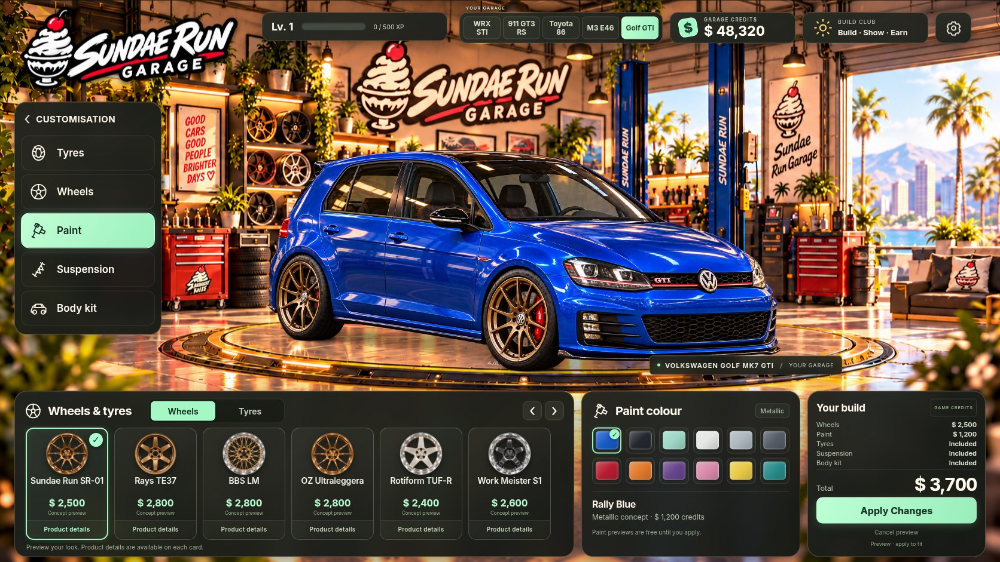

# Sundae Run Garage

Build and show six enthusiast cars in the warm Sundae Run workshop: **Subaru WRX STI, Porsche 911 GT3 RS, Toyota 86, BMW M3 E46, Volkswagen Golf Mk7 GTI and Audi RS3 8Y Sportback**. Each has six rim concepts, twelve paints, road/semi-slick/slick tyres, three suspension settings and original/street/track carbon body packages.



## Play and download

- [Garage game](https://www.sundaerun.com/garage/)
- [Sundae Run website, culture and clothing](https://www.sundaerun.com/)
- [Clothing collection preview](https://www.sundaerun.com/shop.html)
- **[Download the offline game ZIP](https://github.com/bukenbekruip/sundaerun/raw/refs/heads/main/downloads/Sundae-Run-Playable.zip)**

Extract the ZIP completely, then open `OPEN-SUNDAE-RUN.html` in Chrome or Edge. No Node.js installation is needed. If clicking the download does nothing, open [the GitHub file page](https://github.com/bukenbekruip/sundaerun/blob/main/downloads/Sundae-Run-Playable.zip) and choose **Download raw file**. Sign in with repository access if prompted. The exact verified download and its hashes are recorded in `qa/rs3-interiors/release.json`.

The Pages workflow deploys pushes to `main`; a push alone does not prove the deployment finished. Deployment run `39595381851` succeeded for the integrated website and five-car game. Live verification on 21 October 2026 passed 70 website/game checks at desktop and mobile viewport sizes; all website files and game entry/bundles matched the production build. See the progress record for scope and evidence. That verification predates the engine-sound update; this release has separate local production and portable evidence below.

## Build Club

Use the main garage menu for **Interior**, **Performance** or **Sound**. All eight modification categories are visible on phones in two rows. **BUILD CLUB · Build / Show / Earn** in the header also opens your saved builds and briefs:

- **Interior:** choose **Cabin packages** or **Steering wheel**. Every model has Original (included), Sundae Club (1,800 credits), Heritage tan (2,300) and Track Alcantara (2,600) cabins. Steering choices are Factory (included), Alcantara sport retrim (900) and Carbon performance retrim (1,600), with a close-up preview. Cabin and steering purchases are independent, per car, and owned refits are free. Download a PNG of the fitted combination.
- **My builds:** save up to 24 named fitted snapshots, make exterior PNG show cards and share SR1 codes or JSON recipes.
- **Build briefs:** complete seven one-time briefs per car for credits and XP, including a fitted Club cabin build. Save the fitted build before collecting its reward.
- **Performance:** fit a panel filter/intake, exhaust and tune using game credits. Use **Listen · free** to audition any part without buying it. Ratings are fictional progression values, not measured physical gains.
- **Engine sound:** each of the six cars has its own sample-assisted voice, including the RS3 turbo inline-five. Intake and exhaust change tone; tunes change rev response and the game rev limit. Use Start/Stop, Hold to rev, throttle and volume controls. Sound starts only on request and stops when the page is hidden. These are sound concepts, not authenticated model recordings or verified factory specifications. The revised pressure-pulse model removes the continuous sine whistle, adds combustion variation and uses a CC0 mechanical recording residual. Source, licence and processing are recorded in `docs/ENGINE_AUDIO_SOURCES.json`.
- **Import:** inspect a friend's build code and preview its exterior. Imports do not grant purchases, money, rewards, cabin ownership or performance parts.

Free sound auditions last about four seconds and return to the fitted sound. If the engine was off beforehand, the audition stops it afterward. Leaving the section cancels the audition. Volume is remembered separately; sound never autoplays after reload.

Every car keeps its own exterior parts, cabin, steering and performance purchases. Existing saves receive the factory steering finish and an unowned Audi without losing purchases, builds or credits. The wallet is shared. Previews are free; Apply charges only unowned selected exterior parts. The first default wheel-and-paint purchase is 3,700 credits from the initial 48,320. Switching cars cancels unfinished exterior previews. Existing version 2/3/4 saves retain valid purchases, credits and progress; newly added cars start unowned with included baseline parts and an Original cabin.

Cabins are left-hand-drive illustrated views with four coordinated packages per model and independent steering rim retrims. Steering changes retain the factory wheel geometry, hub, controls and airbag illustration. Full aftermarket wheel shapes, individual seats, knobs, mats, lighting and right-hand-drive views remain future additions. Exterior paint does not recolour cabin artwork. Saved builds and progression stay in this browser; there are no online accounts or public gallery yet. Settings offers a confirmed reset of the whole local garage.

## Website

The design-preserving refactor keeps static HTML/ES modules and Vite. Website content remains in `public/website/`; shared header/footer source is in `website/components/`, and the build renders static pages. Readable website/game CSS modules share `src/styles/tokens.css` while retaining their distinct themes. See [the repository audit](docs/ARCHITECTURE_AUDIT.md), [development guide](docs/DEVELOPMENT.md) and [refactor review](docs/REFACTOR_REVIEW.md).

The supplied website is integrated under `public/website/`, retaining its brand design and apparel artwork. Its Play page launches the existing game, and Build Club links back to the website. The Pages production layout puts the website at `/` and the game at `/garage/`; development/portable builds retain their earlier layout. Old jobs/staff/lifts descriptions have been replaced with the actual build-and-show loop and current game images. The original website intake and original game/reference art were preserved.

The website uses the shirt collection’s stacked soft-serve/cherry identity. The clothing preview has **eight designs: two adult and six kids’ styles**, including the new girls’ edit (Cherry Club, Daisy Drive and Lilac Racers) and Mint Mini Crew. Collection jump links and full-size front/back artwork make the designs easy to browse on phones and desktop. Original apparel artwork is preserved; new sources and encoding fingerprints are recorded in `docs/WEBSITE_APPAREL_ART.json`.

The clothing collection is a preview without checkout. Community signup is a local demonstration; it sends no email or personal details to a service. The offline ZIP contains the game; its website link opens the hosted brand site when internet is available. Website-only artwork changes do not rebuild the existing game ZIP.

## Run and build

Use Node.js 22.12 or newer; cloud setup and deployment use Node 24:

```sh
npm ci
npm run dev
```

Open Vite's printed URL. On Windows, use `npm.cmd` if PowerShell blocks `npm.ps1`.

```sh
npm test
npm run build:standalone
npm run preview -- --host 127.0.0.1 --port 4173
```

Normal web output is `dist/` after `npm run build`. `npm run build:standalone` also creates the single-file `dist/OPEN-SUNDAE-RUN.html`, embedding 92 runtime images and the game font. New portable artwork uses compact WebP distribution copies to stay within the unchanged 96 MiB budget. Source PNGs and original reference images are preserved. The legacy `OPEN-THIS-GAME.html` is historical diagnostic material.

`.github/workflows/deploy-pages.yml` tests, runs `npm run build:pages` and deploys `dist/` on `main` pushes or manual workflow runs. The production website is at `/`, the shop at `/shop.html` and the game at `/garage/`; old `/website/` routes remain available. `base: './'` in `vite.config.js` keeps assets relative. Normal development and portable builds retain their existing layout. No backend, app secrets, external fonts or downloaded audio files are required. Web Audio synthesis works in the portable game too.

The intended official Pages domain is **www.sundaerun.com**; the DNS CNAME target is **bukenbekruip.github.io**. See [domain setup and GoDaddy records](docs/GITHUB_PAGES_DOMAIN.md). Confirm GitHub has saved the custom domain before updating DNS; settings changes may require the repository administrator. Public access, the apex redirect and certificate approval then depend on the registrar DNS change. The workflow does not touch registrar or email DNS.

## Verification and artwork

Node tests cover catalogue/state, save migration, independent cabin/steering ownership and saved recipes, rewards, audio source fingerprints and asset geometry. Browser scripts cover native controls, body-only paint pixels, planted wheel/contact probes, cabin transactions and PNG downloads, responsive layouts, missing-image recovery, offline networking and the website/game roundtrip. Current six-car/cabin/steering evidence is in `qa/rs3-interiors/`; previous sound/navigation evidence is in `qa/sound-navigation/`; five-car artwork evidence is in `qa/expansion/`; historical evidence remains in `qa/current/`, `qa/expanded/`, `qa/upgrades/` and `qa/club/`.

Run `python tests/rs3-interior-browser.py` for 72 cabin/steering previews and transactions, or `python tests/sound-browser.py` against the production preview; add `--portable` to test the single file with all extra requests blocked. `python tests/engine-offline.py` uses the Vite dev server to render the production audio graph and save comparison audio.

Read [the progress record](docs/PROGRESS_AND_TEST_RESULTS.md), [art pipeline](docs/ART_PIPELINE.md) and [agreed expansion plan](docs/BUILD_AND_SHOW_PLAN.md). Browser evidence for the portable artifact uses HTTP delivery with every additional request blocked. Managed Chromium blocks direct `file://` navigation, so that protocol is not claimed as tested here.

## Real products and affiliate links

The catalogue keeps fictional game prices separate from optional real retailer offers and vehicle compatibility. No live retailer destinations, affiliate accounts, real prices or verified physical fitment are configured. The shopping-region selector records an international preference only. See [the catalogue guide](docs/PRODUCT_CATALOGUE.md) before adding real merchants.

Real accessories need supplied affiliate destinations, regional availability and verified fitment. Concept illustrations do not establish that a wheel, tyre, seat or engine part fits a real car. Buying a game upgrade never places an order or spends real money.
