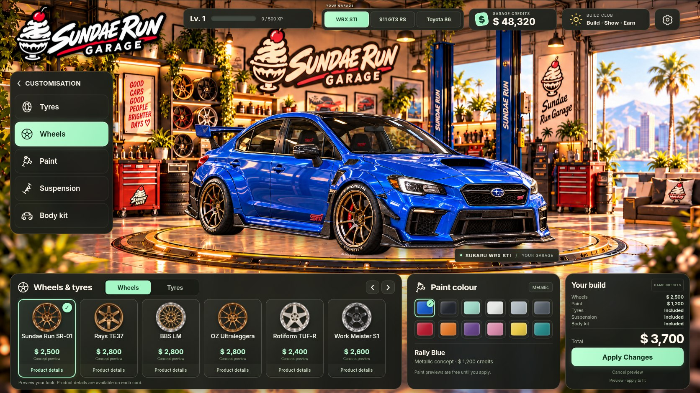

# Sundae Run Garage

A fixed-camera customisation screen with a warm Sundae Run workshop, a gold turntable, live HTML controls, and separate car artwork. Choose a Subaru WRX STI, Porsche 911 GT3 RS or Toyota 86, six wheel concepts and twelve paint colours. Add road, semi-slick or slick tyres, three suspension settings and three carbon body-kit choices. These are concept previews with fictional credits.



## Build Club

Open **BUILD CLUB · Build / Show / Earn** in the garage header. Save up to 24 named fitted builds, complete six one-time briefs per car to earn credits and XP, and fit panel filters/intakes, exhausts and tunes. Each car owns its performance parts separately. Game ratings describe fictional progression, not measured horsepower, audio or verified physical fitment.

Create a PNG show card from a saved snapshot, share an `SR1` build code or export its JSON recipe. Friends can import an exterior preview for free; imports grant no purchases, wallet balance or rewards. Your collection and progression save in this browser with the existing exterior save. Real retailer destinations are not configured; the international region selector records a shopping preference only.

This is the first build-and-show milestone. **The BMW M3 E46, VW Golf Mk7 GTI, model-specific interiors, live community features and connection to the supplied website are still pending.** See [the agreed plan](docs/BUILD_AND_SHOW_PLAN.md). The existing three cars and all their exterior options are retained.

## Download and play

**[Download Sundae Run ZIP](https://github.com/bukenbekruip/sundaerun/raw/refs/heads/main/downloads/Sundae-Run-Playable.zip)** (about 54 MB). Sign in to GitHub with access to this repository if prompted. Extract the ZIP, then open `OPEN-SUNDAE-RUN.html` in Chrome or Edge. No Node.js installation is needed for this download.

If the download does not start, [open the ZIP's GitHub file page](https://github.com/bukenbekruip/sundaerun/blob/main/downloads/Sundae-Run-Playable.zip) and choose **Download raw file**. The file is a copy of the verified upgrade build recorded in `qa/upgrades/release.json`.

## Run the source

Use Node.js 22.12 or newer; the cloud setup uses Node 24. Open a terminal in the folder containing `package.json`:

```sh
npm ci
npm run dev
```

Open the URL Vite prints. On Windows, use `npm.cmd` if PowerShell blocks `npm.ps1`.

## Build a portable game

```sh
npm run build:standalone
```

The current portable game is `dist/OPEN-SUNDAE-RUN.html`. It embeds the code, fonts and runtime images in one file. Save that file to your computer and open it in Chrome or Edge. The legacy `OPEN-THIS-GAME.html` is the old V2 diagnostic demo and is kept as handover history.

For a normal web deployment, publish the contents of `dist/` after `npm run build`. Preview that build with `npm run preview`. The application is built as a real JavaScript module; no manual script-copy workaround is required.

## GitHub Pages deployment

In the repository's **Settings → Pages**, select **GitHub Actions** as the build source. `.github/workflows/deploy-pages.yml` tests and builds the game with Node 24, then deploys `dist/` on pushes to `main` or a manual workflow run. The expected project address is `https://bukenbekruip.github.io/sundaerun/` once deployment succeeds.

Keep `base: './'` in `vite.config.js`: scripts, styles, fonts and runtime artwork then resolve within the `/sundaerun/` project directory. No backend, external image host or application secrets are required. The portable ZIP is independent of Pages and does not need rebuilding for deployment-only changes.

The cloud onboarding chat does not expose its internal server as a public preview. A localhost address printed there belongs to the cloud machine. Use the portable game to try this build on your computer, or deploy the normal `dist/` build to a static host for a shareable web address.

## Game behaviour

- Previewing is free. Cancel restores the last applied appearance.
- Applying the default wheel and paint combination costs 3,700 fictional credits, taking the initial balance from 48,320 to 44,620. Owned parts can be fitted again without another charge.
- Applied choices and balance save in the current browser. Uncommitted previews do not become applied changes after a reload.
- Each car remembers its applied build and owned parts. Switching cars discards an unfinished free preview and restores that car's saved build; the credit balance is shared. Existing STI and three-car saves migrate automatically, keeping valid credits and purchases.
- Tyre changes preserve size and rim geometry. Suspension lowers the rigid body while the wheels stay planted. Street and track kits add carbon splitters, canards and sill details.
- The original tyre, suspension and body options are included; upgraded parts are purchased once per car.
- Settings includes a confirmed reset. Missing scene images keep Apply disabled and offer Retry.
- Desktop artwork and controls scale together. Narrow screens retain the whole car and use readable scrolling controls.

## Real products and affiliate links

`src/catalogue.js` holds product data independently of artwork and game state. It supports a retailer URL, real price and currency, affiliate disclosure and fitment metadata. No retailer URLs or verified physical-product fitment are configured yet. See [the catalogue guide](docs/PRODUCT_CATALOGUE.md) before adding a merchant.

The current car/wheel images are concept illustrations. Adding a real product requires its own product data and a matching preview if it will alter the car. A product photograph alone is not a calibrated wheel render.

## Validation

```sh
npm test
npm run build:standalone
```

The cloud's Chromium checks use Python Playwright, `/usr/bin/chromium`, and a running production preview:

```sh
python3 tests/browser-smoke.py
python3 tests/portable-smoke.py
python3 tests/club-browser.py
python3 tests/club-browser.py --portable --output qa/club/portable
```

Those scripts cover five-part transactions, per-car persistence, save migration, image-load races and failures, the 216 baseline paint combinations, 486 blue mechanical combinations and representative painted upgrades, viewport sizing, protected paint/tyre pixels and wheel contacts, and the portable build's resource independence. Current upgrade screenshots and results are in `qa/upgrades/`; the earlier three-car release remains in `qa/expanded/`; the first release's evidence remains in `qa/current/`. The visual review and known limits are recorded in [the progress log](docs/PROGRESS_AND_TEST_RESULTS.md).

Current Build Club evidence is in `qa/club/`; the older release folders remain historical. After a passing production and portable Club run, `python3 scripts/package-playable.py` packages the exact tested HTML and writes current release hashes. The previous full exterior matrix is not automatically revalidated by a Club-only test run.

## Project map

- `app.js`, `index.html`, `src/ui.css`: live interface and scene controller.
- `src/state.js`: per-car builds and ownership, shared balance, previews, purchases and save migration.
- `src/catalogue.js`: catalogue and optional merchant data.
- `src/scene.js`, `public/assets/scene/`, `public/assets/cars/`: registered full-car wheel variants and vehicle placement.
- `src/paint-renderer.js`: authored paint regions, protected trim/glass/light/wheel regions and runtime paint rendering.
- `src/upgrade-renderer.js`, `public/assets/upgrades/`: authored rubber clipping, fixed wheel extraction, rigid body lowering and registered carbon additions.
- `public/assets/products/`: clean product thumbnails.
- `reference/`, `source-art/`: original artwork preserved from the handover.
- `CODEX_HANDOFF.md`, `README_START_HERE.md`, `FILE_MANIFEST.json`: historical transfer context and original checksums.
